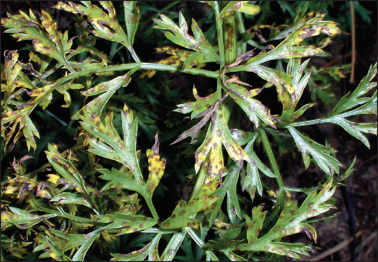

## Alternaria and Cercospora Leaf Blights (Carrot)

 ***Alternaria*** **and *Cercospora* leaf blights** are common fungal diseases of carrot leaves and petioles. While neither disease directly hurts the carrot root, yield loss occurs when petioles become so brittle that they break off during mechanical harvest leaving the carrot in the ground. In warm, moist weather, *Alternaria* leaf spots develop rapidly so that the entire field may appear to have been injured by frost or chemicals. Crop loss will be more severe when plants become infected early in the season.

*Alternaria* and *Cercospora* are difficult to distinguish in the field and often appear on the same plant. The principle difference involves disease timing. Cercospora leaf blight, caused by the fungus *Cercospora carotae*, attacks young rapidly growing plants; Alternaria leaf blight, caused by the fungus *Alternaria dauci*, primarily attacks older plants, although seedlings may also be infected.

### Model details

This Alternaria model is an implementation of the TOMCAST model described in Pitblado 1992, which builds on the FAST forecaster described by Madden et al 1978. The model generates daily Disease Severity Values (DSVs) based on the mean temperature and duration of leaf wetness periods (hours with relative humidity at or above 90 %, from 8 pm the evening before, used in place of leaf wetness).

The daily values follow the FAST table of Madden et al. (1978). The risk level comes from the last 7 days' total. Guides and trials time sprays by the total since the last spray: the Midwest Vegetable Production Guide uses 15 DSVs, Cornell suggests spraying again once more than 15 have built up, and in Wisconsin trials spraying after each 15 to 20 DSVs cut fungicide use by 30 to 50 % from weekly sprays without losing control or yield. A High week that began before a recent spray may not call for another, and a total can reach 15 over several weeks while each week stays Low or Moderate. FAST and TOMCAST were developed for early blight of tomato; their use for carrot leaf blights rests on extension practice and trials.

Updated November 2026: humid hours and their mean temperature now come from the same window (from 8 pm the evening before), and the daily values follow FAST's published table.

### References

-   Pitblado 1992: TOM-CAST Tomato Disease Forecaster <https://atrium.lib.uoguelph.ca/server/api/core/bitstreams/5c7ec712-43ef-4b73-b8b8-e85c29d3d58b/content>
-   Madden et al 1978: FAST, a Forecast System for Alternaria solani on Tomato. Phytopathology 68:1354. <https://doi.org/10.1094/Phyto-68-1354>
-   More information: <https://vegpath.plantpath.wisc.edu/diseases/carrot-alternaria-and-cercospora-leaf-blights/>
