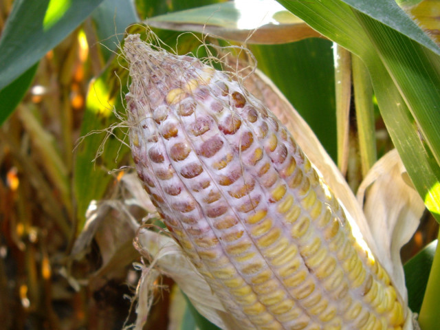

## Gibberella Ear Rot / Deoxynivalenol (Corn)

**Gibberella ear rot** is caused by the fungus *Gibberella zeae* (synonym *Fusarium graminearum*). It is a consistently important mycotoxigenic fungus in the northern Corn Belt, producing **deoxynivalenol** (DON or vomitoxin), zearalenone, and other toxins. Gibberella ear rot can be identified most readily by the red or pink color of the mold. It almost always begins at the tip of the ear. Excessive mold may cause silks and husks to adhere to the ear. In severe cases, the pink mold is visible on the outside of the husks at the ear tip.

This fungus overwinters in corn residue. Spores are spread by splashing rain and wind, infecting ears through the silks. Silks are most susceptible two to six days after emergence. This ear rot is common, particularly when conditions are cool and wet during grain fill.
After infection DON is produced by the fungus. DON accumulation is favored when conditions after silking remain moderately warm and wet (including frequent rain and high humidity). 

It is important near harvest to scout fields for ear rot and collect grain samples for DON testing. Frequent testing during harvest is also recommended. Grain elevators typically dock for high DON levels in grain, so it is important to know what concentrations you are dealing with before grain delivery.

### Model Details

The DON model is based on logistic equations developed by Paul and Nesi which calculate the probability of DON above 1 ppm at harvest. Risk scores are assigned based on probabilities formulated in the model using weather parameters around the corn silking growth stage.

The model's weather windows end at silking: temperature and rain from about 3 weeks to 1 week before silking, and humidity in the 2 weeks before it. In the Ohio data it was fitted on, wetter weather in those weeks went with **less** DON at harvest, consistent with published work showing that moisture before silking is negatively related to DON and moisture after silking positively (Dalla Lana, Madden and Paul 2021, Phytopathology 111:2397, <https://doi.org/10.1094/PHYTO-03-21-0104-R>). Weather after silking, which favors DON as described above, isn't in this model. The value shown on each day is the probability for a field that silks that day. The model was developed on Ohio data with NASA POWER daily weather; the risk levels (Moderate from 20 %, High from 40 %) are the tool's. Days with missing rain data are counted as dry, and the number of such days is shown in the chart label.

### More Information
-   Gibberella ear rot: <https://cropprotectionnetwork.org/encyclopedia/gibberella-ear-rot-of-corn>
-   Mycotoxin FAQ: <https://cropprotectionnetwork.org/publications/mycotoxin-faqs>
-   Grain and silage testing: <https://cropprotectionnetwork.org/publications/grain-and-silage-sampling-and-mycotoxin-testing>
-   Deoxynivalenol accumulation in silage: <https://cropprotectionnetwork.org/publications/wheres-don-understanding-where-deoxynivalenol-don-accumulates-in-corn-silage>

