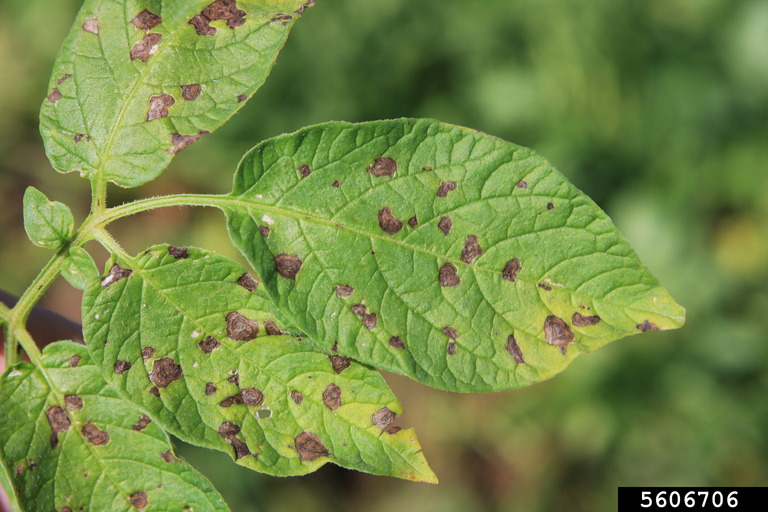

## Early Blight (Potato/Tomato)

**Early blight** is a common fungal disease of solanaceous crops (tomatoes, potatoes, peppers, eggplants) caused by *Alternaria solani*. Symptoms first appear as circular dark-brown spots on leaves and stems that can later develop concentric, target-like rings, often surrounded by yellow margins. Lesions are sometimes limited by veins, giving an ‘angular’ appearance. Early foliar symptoms often appear near the base of the plant, spreading up to higher leaves as the disease progresses. On tubers, lesions appear as dark, sunken, cork-like spots with raised margins, although tuber symptoms are less frequently seen in the Midwestern U.S.

When conditions are right, overwintering spores (conidia) can travel within and between fields and infect healthy plant tissue. Spores can spread via wind, splashing rain, irrigation water, equipment, and workers. Spores can then spread locally from infected tissue in a similar manner. Favorable conditions for early blight development and spread include canopy closure, high humidity, prolonged leaf wetness, poor airflow, nitrogen deficiency. Older or senescing leaves are most susceptible to early blight infection. Once the growing season is over, the pathogen can overwinter on infected soil-bound plant debris for several years.

### Model details

The early blight model is based on the accumulation of potato physiological days (P-days) as described in Pscheidt and Stevenson 1988. P-days (Sands, Hackett and Nix 1979) measure heat for potato development: development is fastest at 70°F (21°C) and stops below 45°F (7°C) and above 86°F (30°C). UW Vegetable Pathology times the first fungicide spray at about 300 P-days from crop emergence (or transplanting for tomato, pepper and eggplant). The threshold comes from Pscheidt and Stevenson's research in Wisconsin: in their 1986 comparison, starting sprays at 300 P-days controlled early blight on cultivars of different maturity. Their 1988 study found that for Russet Burbank, a late-maturing variety, the critical period for control came after about 400 P-days, so first sprays on that variety could wait until then; earlier varieties need their own study. Until 400 P-days the season total sets the risk (Low from 200, Moderate from 250, High from 300, Very high from 350); from 400 the average daily P-days over the past 7 days do (Low from 1, Moderate from 3, High from 5, Very high from 9), so the level can drop at 400. Treat 300 as the point at which protection should start, whatever the level after it.

Updated November 2026: the daily P-day calculation now weights the daily high in its last term, following Sands et al. (1979).

### References

-   Sands, P. J., Hackett, C. and Nix, H. A. 1979. A model of the development and bulking of potatoes (*Solanum tuberosum* L.). I. Derivation from well-managed field crops. Field Crops Research 2:309–331. <https://doi.org/10.1016/0378-4290(79)90031-5>
-   Pscheidt, J. W. and Stevenson, W. R. 1986. Comparison of forecasting methods for control of potato early blight in Wisconsin. Plant Disease 70:915–920. <https://doi.org/10.1094/PD-70-915>
-   Pscheidt and Stevenson 1988: The critical period for control of early blight (Alternaria solani) of potato <https://link.springer.com/article/10.1007/BF02854357>
-   More information: <https://vegpath.plantpath.wisc.edu/diseases/potato-early-blight/>
