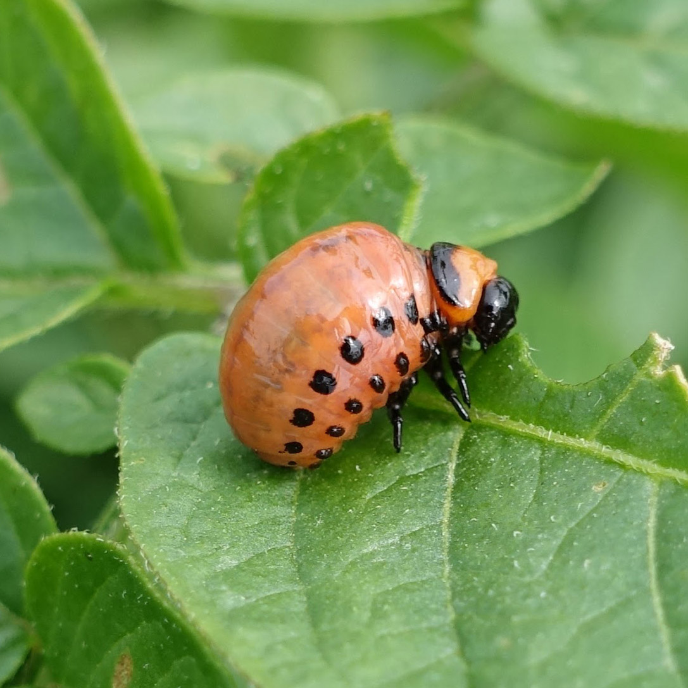

## Colorado Potato Beetle

The Colorado potato beetle (*Leptinotarsa decemlineata*) is a significant pest of potato, eggplant and pepper in home gardens as well as fresh market agricultural production. When not controlled, Colorado potato beetle (CPB) can completely defoliate plants resulting in serious yield losses or even plant death. Beetles prefer to feed on potato, but will also use eggplant and other solanaceous crops. Both larval and adult life stages commonly cause damage to plants throughout the growing season. CPB is a persistent pest annually, once an infestation occurs beetle populations tend to increase annually. When potato is unavailable in the environment CPB can utilize alternate solanaceous host plants such as eastern black and deadly black nightshade, jimson-weed, Carolina horse-nettle and buffalo-bur. Common solanaceous weeds in the environment are thought to provide a green bridge enabling potato beetle colonization into new environments.

### Model details

Degree days are counted from January 1 by the single-sine method, base 52°F with a cutoff at 86°F. The model reads four curves fitted to scouting counts from commercial potato fields in the Central Sands, 2014–2025 (Bradford and Groves, UW–Madison Vegetable Entomology, unpublished analysis of Pest Pros' scouting data): adults and larvae per 25 sweeps of a standard sweep net, egg masses per 10 plants, and adults and larvae together. Each value is a typical count for fields at that point in the season, not a count for your field.

- **Colonization:** overwintered adults begin to appear at about 210 degree days.
- **Egg masses** from about 240, most numerous around 580.
- **Larvae** hatch from about 375 and peak around 795.
- **Adults** peak around 590, fall to a low around 960, and peak again around 1,480 as the summer generation emerges; a partial third generation shows around 1,980 in some years.
- **Adults and larvae together** peak around 810, dip slightly around 1,040 and peak again around 1,350.

Risk compares today's count of adults and larvae with the season's peak: Low from 5 % of the peak, Moderate from 25 %, High from 50 % and Very high from 75 %. The scouting data end at about 2,310 degree days; after that the counts stay where they were until fall freezes end the season.

The timing is much the same from year to year, but the numbers vary: some years' counts run well below others' at the same degree days. The counts are typical values, below the average of fields' counts, and individual fields vary widely around them. The curves describe the data they were fitted to and haven't yet been tested on other years or fields. Outside the Central Sands, and in tomato and eggplant, the timing is likely similar but numbers may differ. Use the model to know which stage to scout for and when, and scout to see how many beetles you have.

Updated November 2026: the model now reads curves fitted to the scouting counts on base 52°F degree days, replacing a step table on base 50°F.

### More Information

- <https://vegento.russell.wisc.edu/pests/colorado-potato-beetle/>
