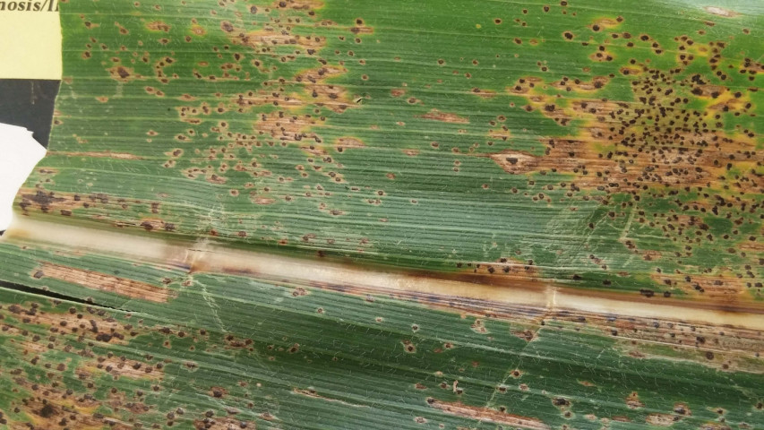

## Tar Spot (Corn)

**Tar spot** is caused by the fungus *Phyllachora maydis*, and can cause severe yield loss on susceptible hybrids when conditions are favorable for disease. Tar spot appears as small, raised, black spots scattered across the upper and lower leaf surfaces. These spots are stromata (fungal fruiting structures). If viewed under the microscope, hundreds of sausage-shaped asci (spore cases) filled with spores are visible. When severe, stromata can even appear on husks and leaf sheaths.

Tan to brown lesions with dark borders surrounding stromata can also develop. These are known as "fisheye" lesions. In Latin America, where tar spot is more common, fisheye lesions are associated with another fungus, Monographella maydis, that forms a disease complex with P. maydis known as the tar spot complex. M. maydis has not been detected in the United States.

At the end of the growing season, common and southern rust pustules can be mistaken for tar spot stromata as these rusts switch from producing orange-red spores (urediniospores) to black spores (teliospores). However, rust spores burst through the epidermis and the spores can be scraped away from the pustules with a fingernail while tar spots cannot be scraped off the leaf tissue.

The pathogen that causes tar spot overwinters on infested corn residue on the soil surface, and it is thought that high relative humidity and prolonged leaf wetness favor disease development.

Residue management, rotation, and avoiding susceptible hybrids may reduce tar spot development and severity. Some fungicides may also reduce tar spot, although little data exists regarding application timing for efficacy and economic response.

### Model details

The tar spot model averages two logistic equations from Webster et al. (2023), fitted to whether tar spot severity increased between two ratings of the same field in Midwest plots and fields. One uses the 30-day average daily mean temperature and daily maximum relative humidity; the other the 30-day average temperature and the 14-day average of night hours (8 pm to 6 am) with relative humidity at or above 90 %. In both, warmer weather and more humid nights lower the probability, as the authors found. Because the equations rise toward 100 % in cold weather, when corn isn't growing, this tool scales the probability down in proportion when the 21-day average daily low is below 50°F (10°C), and to 0 below 32°F (0°C). That scaling is the tool's addition, not part of Webster et al.'s model; it has no effect from July to mid-August. Risk levels: Low from 1 %, Moderate from 20 %, High from 35 %.

### More information

-   Webster et al 2023: Uncovering the environmental conditions required for Phyllachora maydis infection and tar spot development on corn in the United States for use as predictive models for future epidemics <https://doi.org/10.1038/s41598-023-44338-6>
-   Crop protection network: <https://cropprotectionnetwork.org/encyclopedia/tar-spot-of-corn>
